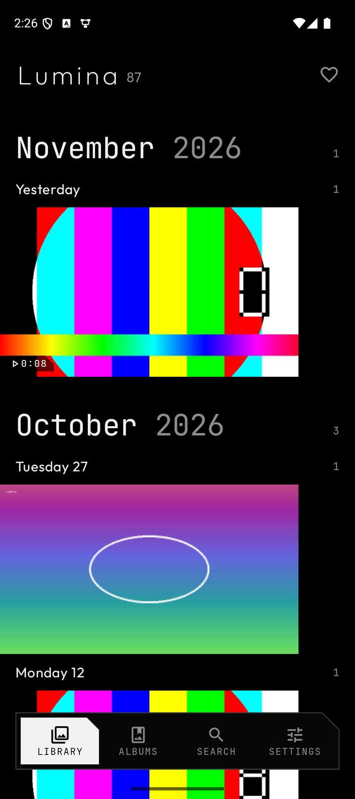
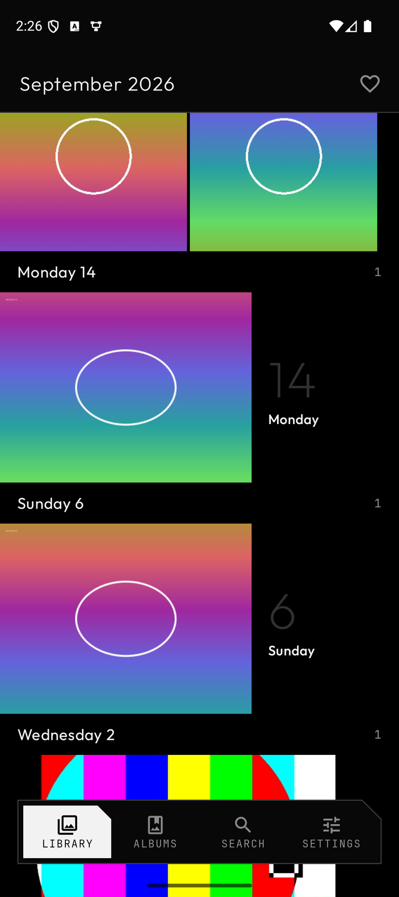
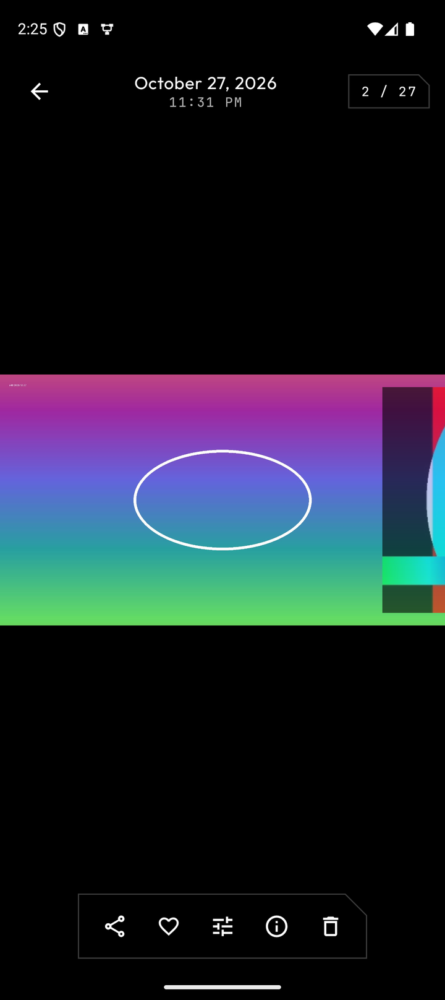
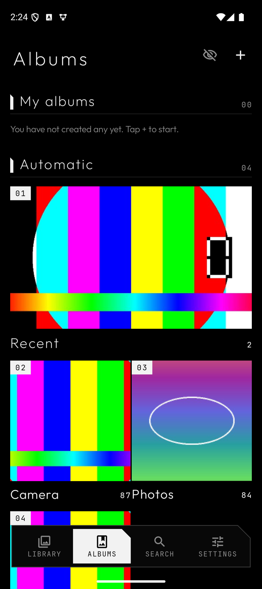
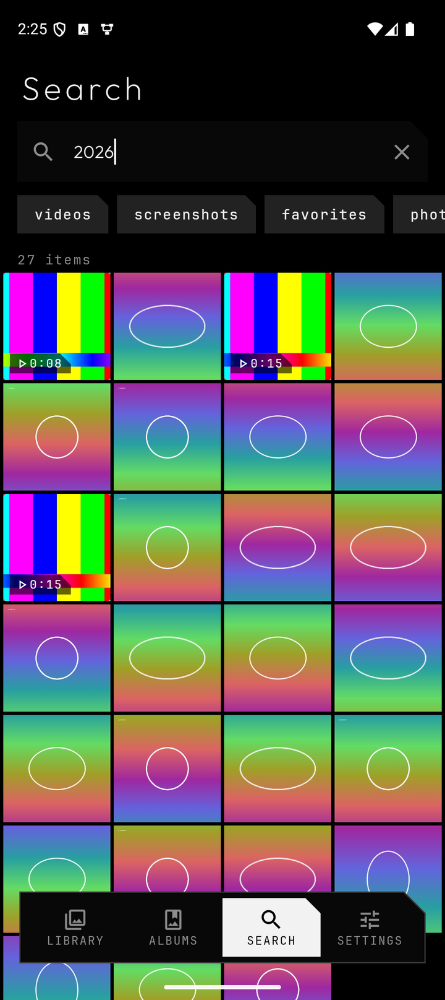
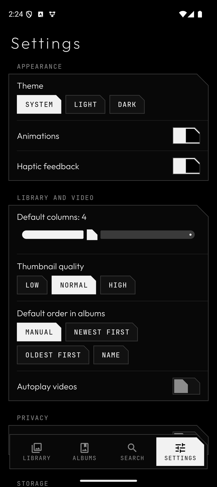
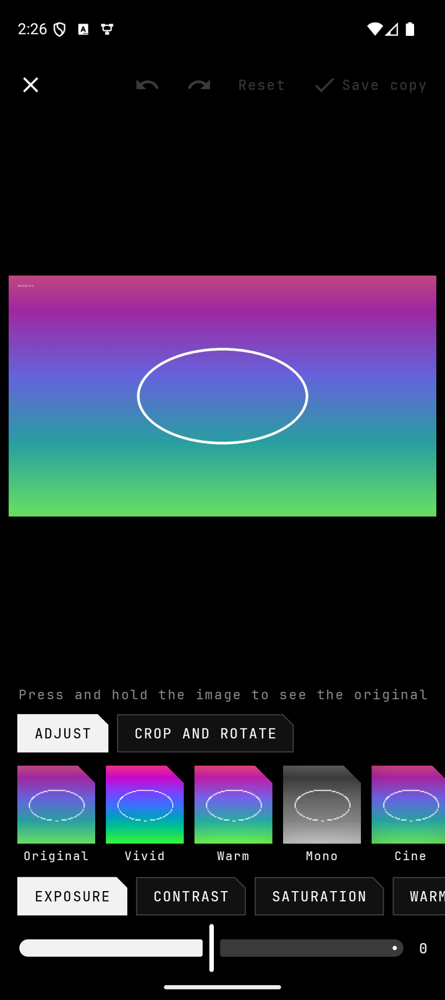
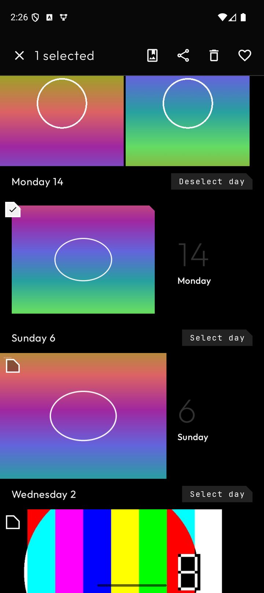

# Lumina

Galería multimedia para Android (Kotlin, Jetpack Compose, MVVM): biblioteca cronológica, álbumes, visor con vídeo, editor no destructivo y búsqueda por metadatos. Todo se queda en el dispositivo.

| Biblioteca | Por días | Visor | Álbumes |
|---|---|---|---|
|  |  |  |  |

| Búsqueda | Ajustes | Editor | Selección |
|---|---|---|---|
|  |  |  |  |

Capturas reales (`adb screencap`) de la app release corriendo en un emulador Pixel_API36 (Android 16) con fotos y vídeos sintéticos generados con `tools/seed-media.py`; no contienen datos personales.

## Características

- **Biblioteca** cronológica por días desde MediaStore, con meses/años gigantes, scrubber temporal, selección múltiple (pulsación larga, «elegir día»), favoritos locales y pellizco para 2–7 columnas.
- **Visor**: paginador, zoom con pellizco y doble toque, transición compartida, información EXIF y ubicación, compartir, papelera del sistema y favoritos.
- **Vídeo** integrado con Media3 ExoPlayer: reproducir/pausa, progreso, volumen, doble toque ±10 s y giro a horizontal en modo inmersivo.
- **Álbumes**: manuales (Room, con migración 1→2: nombre, descripción, portada, ocultos, reordenar y orden Manual/fecha/nombre), automáticos (recientes, cámara, capturas, descargas, fotos, vídeos, favoritas) y carpetas del dispositivo.
- **Editor no destructivo** (imágenes): exposición, contraste, saturación, temperatura, sombras, luces, nitidez y viñeta; recorte libre o por proporción, giro 90° y espejo; deshacer/rehacer, comparar con el original (mantener pulsado) y guardar copia en `Pictures/Lumina` conservando el EXIF (nunca sobrescribe el original).
- **Búsqueda por metadatos** (nombre, carpeta, tipo, mes, año, favoritas, capturas; sin acentos, es/en). No hay reconocimiento de imagen.
- **Ajustes** (DataStore): tema, animaciones, vibración, columnas, calidad de miniaturas, orden de álbumes, autoplay y «proteger pantalla» (`FLAG_SECURE`).
- Interfaz en español e inglés.

## Instalación

Descarga `lumina-0.1.0.apk` de la [última release](../../releases/latest) y comprueba el `sha256` publicado junto a él:

```
sha256sum -c lumina-0.1.0.apk.sha256
adb install -r lumina-0.1.0.apk
```

> **Aviso:** el APK está **firmado con la clave de depuración** de Android. Sirve para probar la app; no es una firma de producción, no pasa por Play Store ni Play Protect y Android puede avisar al instalarlo. Requiere Android 11 (API 30) o superior.

## Permisos

| Permiso | Para qué |
|---|---|
| `READ_MEDIA_IMAGES`, `READ_MEDIA_VIDEO` | Leer las fotos y vídeos de MediaStore |
| `READ_MEDIA_VISUAL_USER_SELECTED` | Acceso parcial («fotos seleccionadas») en Android 14+ |
| `READ_EXTERNAL_STORAGE` (hasta API 32) | Lo mismo en versiones anteriores a Android 13 |
| `ACCESS_MEDIA_LOCATION` | Mostrar la ubicación guardada en el EXIF |

## Compilar desde el código

Requisitos: JDK 17 o superior (el proyecto compila a Java 17; verificado con JDK 27), Android SDK con la plataforma 37 (`compileSdk 37`, `targetSdk 36`, `minSdk 30`) y el Gradle wrapper incluido (Gradle 9.8.1, AGP 9.4.1, Kotlin 2.4.21).

```
./gradlew :app:assembleDebug      # app/build/outputs/apk/debug/
./gradlew :app:assembleRelease    # R8 + recursos reducidos, firmado con la clave de depuración
```

Para ver la app con datos de demostración en un emulador (nunca en un móvil real):

```
emulator -avd Pixel_API36 -read-only -no-snapshot &
python3 tools/seed-media.py emulator-5554 120   # siembra fotos y vídeos sintéticos
adb -s emulator-5554 install -r app/build/outputs/apk/release/app-release.apk
```

## Pruebas

```
./gradlew :app:testDebugUnitTest                                              # JVM
ANDROID_SERIAL=emulator-5554 ./gradlew :app:connectedDebugAndroidTest         # instrumentadas, con emulador
```

Fija siempre el serial: si hay un móvil conectado, Gradle intenta instalar también ahí. Los resultados de verificación anteriores (tests, rendimiento, recorridos en pantalla) están en [docs/NOTAS-TECNICAS.md](docs/NOTAS-TECNICAS.md); el diseño, en [docs/ARQUITECTURA.md](docs/ARQUITECTURA.md). Estas pruebas no se han vuelto a ejecutar al preparar esta publicación; sí se compiló la release y se comprobó que instala y arranca sin errores en el emulador.

## Identidad visual

Sigue la identidad visual de Takumi-Organization: papel negro y tinta clara, monocromo estricto (sin acento ni cristal), esquinas rectas con corte diagonal arriba a la derecha, selección por inversión. Tipografías **Outfit** y **JetBrains Mono**, bajo licencia SIL OFL 1.1 ([licencias](docs/licencias/)).

## Estado y límites conocidos

- Verificado en emulador y en un móvil físico (Xiaomi); sin probar en otros fabricantes.
- Las cifras de rendimiento del emulador sirven para comparar versiones, no para prometer fluidez en un móvil concreto.
- Editor: vista previa en CPU a 1280 px y exportación hasta 4096 px de lado mayor; no se conserva EXIF en copias PNG.
- Los álbumes ocultos solo se ocultan de la lista; favoritos y álbumes son locales (Room) y no se sincronizan con otras apps.
- Defectos visuales conocidos, sin corregir: tras abrir una foto aparece un fragmento fantasma de la página siguiente en el borde derecho del visor, y en Álbumes el contador «87» queda pegado al nombre «Photos» junto a «Camera». El botón de información del visor no abrió su panel en una prueba manual (sin confirmar si es un fallo real).
- No aparecen carpetas con `.nomedia`, archivos pendientes, elementos en papelera ni perfiles de trabajo: Lumina solo lee lo que MediaStore indexa.

## Licencia

[MIT](LICENSE), © 2026 Takumi-Organization. Las fuentes Outfit y JetBrains Mono se distribuyen bajo SIL OFL 1.1 (`docs/licencias/`). Las dependencias (AndroidX, Compose, Room, Media3, Coil, Kotlin) son de código abierto con licencia Apache 2.0.
